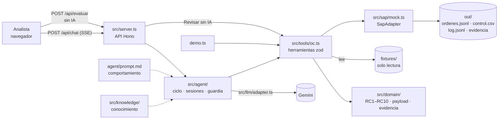
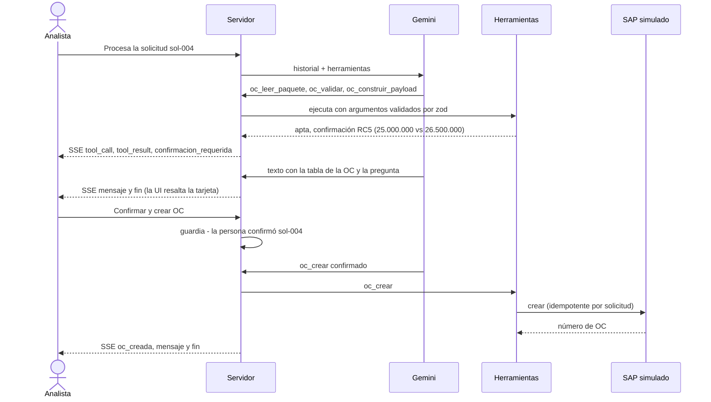
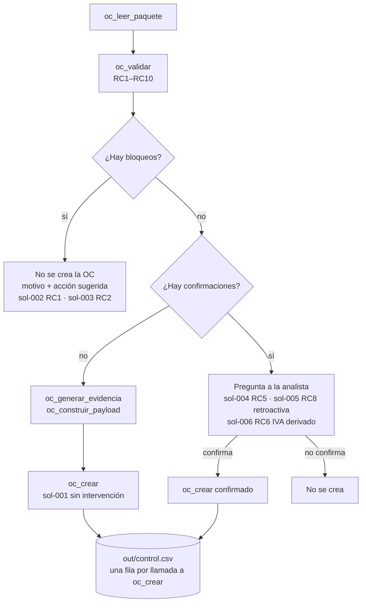

# Reto 3 · Agente de Órdenes de Compra (SAP simulado)

Agente conversacional en TypeScript que lee el paquete de una compra (solicitud, cotización, aprobación, factura), lo valida contra los maestros con las reglas RC1–RC10, genera la evidencia y crea la orden de compra (OC) en un SAP simulado. Lo dudoso se devuelve a una persona con los dos valores a la vista; el modelo (Gemini) orquesta y explica, y no puede crear una OC sin confirmación humana.

- **Link público:** https://reto-03-periferia-oc-production.up.railway.app
- **Repositorio:** https://github.com/JaimeUDistrital/reto-03-periferia-oc
- **Planteamiento completo:** [SOLUCION.md](SOLUCION.md)

## Requisitos

- **Node.js ≥ 22.12** (`.nvmrc` fija la línea 22). Es el mínimo que piden las dependencias: `@google/genai` exige Node ≥ 22 y Vite ≥ 22.12 (fuente: `package-lock.json`). Probado con Node 22.23.4 (Railway) y 26.13.0 (local).
- **Bun 1.4.4** para la demo del PRD: `bun install && bun run demo.ts` probado en una copia limpia del repositorio (exit 0, 6/6 casos; dos ejecuciones dan la misma salida salvo fechas). El servidor se arranca con Node.
- Versiones exactas: `package.json` no usa rangos (`^`, `~`) y `package-lock.json` está versionado con los binarios nativos de Windows, macOS y Linux. Usa `npm ci` para instalar exactamente lo probado.
- Para el chat con IA: una clave de la API de Gemini. Sin clave, el chat avisa y el botón «Revisar sin IA», la demo y los tests funcionan igual.

## Arranque local (un comando)

```bash
npm ci && npm run dev
```

`npm run dev` compila el front y levanta el backend (API y web en el mismo proceso) en `http://localhost:3000`. Para el chat con IA, copia `.env.example` como `.env` en la raíz y pon tu clave: `npm start` lo carga solo si existe (`node --env-file-if-exists`); las variables ya definidas en el entorno tienen prioridad.

Demo sin modelo ni clave, como pide el PRD:

```bash
bun install && bun run demo.ts     # o: npm ci && npm run demo
```

## Cómo funciona

**Piezas.** El modelo solo decide qué herramienta llamar y redacta; validar, construir y crear lo hace código determinista. La demo y «Revisar sin IA» usan las mismas herramientas sin modelo.



**Un caso con confirmación humana (sol-004).** El modelo no puede confirmar por su cuenta: `oc_crear` consulta una guardia del servidor que solo da paso si el último mensaje de la persona confirmó ese caso.



**Qué pasa con cada caso.** Resultado de `npm run demo` sobre los 6 fixtures (n=6).



Cada llamada a `oc_crear` deja una fila en `out/control.csv` con su resultado (`creada`, `existente`, `bloqueada` o `pendiente`) y la marca `retroactiva` (sol-005 queda en `true`).

## Variables de entorno

La plantilla es `.env.example`. La clave real nunca se versiona.

| Variable | Para qué | Valor por defecto |
|---|---|---|
| `GEMINI_API_KEY` | Clave de la API de Gemini. Solo la lee el backend | vacía: el chat avisa |
| `GEMINI_MODEL` | Modelo de Gemini | `gemini-3.6-flash` |
| `PORT` | Puerto HTTP | `3000` |
| `MAX_ITERACIONES` | Tope de vueltas herramienta → modelo por turno | `25` |
| `MAX_TOKENS_SESION` | Tope de tokens acumulados por sesión | `200000` |

## Comandos

| Comando | Qué hace |
|---|---|
| `npm run dev` | Compila el front y levanta el backend |
| `npm run demo` | Procesa los 6 casos llamando a las herramientas, sin modelo ni clave |
| `npm test` | Ejecuta los tests (`node:test`) |
| `npm run typecheck` | Comprueba tipos del servidor y del front |

### Qué imprime `npm run demo`

Por cada caso de `fixtures/reto-03/solicitudes/`: `apta`, bloqueos, confirmaciones, `retroactiva`, y el número de OC o el motivo de que no se cree. También muestra la idempotencia (sol-001 dos veces devuelve la misma OC) y la confirmación explícita de sol-004. Con `out/` limpio la numeración sale `4500000001` a `4500000004`. Termina con «OK: los 6 casos coinciden con casos.esperados.ts» y código de salida 0; si un caso no coincide, sale con 1.

## API

| Método | Ruta | Qué hace |
|---|---|---|
| `POST` | `/api/chat` | `{ sessionId, message, confirmar? }` → stream SSE de eventos (`tool_call`, `tool_result`, `confirmacion_requerida`, `oc_creada`, `mensaje`, `error`, `fin`) |
| `GET` | `/api/sessions/:id` | Historial completo de la sesión |
| `GET` | `/api/health` | `{ ok, provider, model, llm_configurado }`, sin exponer claves |
| `GET` | `/api/casos` | `{ casos: ["sol-001", …] }` |
| `POST` | `/api/evaluar` | `{ caso, sessionId? }` → SSE con los mismos eventos: lee, valida y arma el payload sin IA y sin crear la OC |

Errores: `400` cuerpo inválido, `404` caso o sesión inexistente, `409` sesión ocupada, `413` cuerpo grande, `429` demasiadas peticiones; siempre con `correlationId`.

## Estructura

```
agent/prompt.md              comportamiento: system prompt del agente
src/server.ts                API HTTP (Hono)
src/agent/                   ciclo del agente, sesiones, guardia de confirmación, bitácora
src/domain/                  reglas RC1–RC10, payload, evidencia, contratos (zod)
src/data/                    lectura de fixtures, control.csv, candado, Excel
src/security/                redact, mask, límites
src/llm/                     adapter.ts (interfaz) y gemini.ts (implementación)
src/tools/oc.ts              ejecución: herramientas con zod (cada export → oc_<export>)
src/sap/                     adapter.ts (interfaz SapAdapter) y mock.ts (sobre out/sap/)
src/knowledge/               conocimiento: ordenes-compra.md
web/                         front de chat (React)
modulo/                      bonus: agente empaquetado como módulo reutilizable
fixtures/                    entradas del reto, solo lectura
out/                         generado en ejecución (OC simuladas, control.csv, evidencia, log)
demo.ts                      las herramientas sin modelo
docs/                        PLAN, RELEVO, GLOSSARY
```


## Prompt de demo

En una sesión nueva del chat:

```
Procesa la solicitud "sol-004". Muéstrame la OC como quedaría en SAP, qué
validaciones pasó y cuáles no, y no la crees hasta que yo lo confirme.
```

Resultado esperado: la OC resumida en una tabla, la confirmación RC5 con los dos valores (solicitud 25.000.000 vs cotización 26.500.000), las llamadas a herramientas visibles y una pregunta que cierra el turno. Tras escribir «confirmo», el número de OC y la ruta de la evidencia.

## Seguridad

La clave de Gemini vive solo en el backend, en variable de entorno. No aparece en el front, el repositorio, los logs ni las respuestas de la API. Las herramientas no ejecutan comandos de shell. El link público no tiene autenticación; los datos son ficticios.
