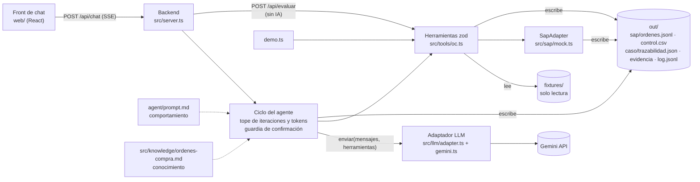

# SOLUCION · Reto 3 · Agente de Órdenes de Compra (SAP simulado)

Convenciones: lo que no pude comprobar en una fuente va marcado «(no verificado)». Las cifras agregadas indican su población: los fixtures son 6 casos (n=6) y no son una muestra estadística.

## 1. Problema en una frase y a quién le duele

Cada compra llega por correo en tres piezas (Excel, cotización, aprobación) y la analista administrativa la digita a mano en SAP; eso cuesta tiempo, deja el control de «quién puede aprobar cuánto» en la memoria de una persona y no mide cuántas OC se crean después de la factura.

- **Analista administrativa:** digitación repetida, una por factura, con riesgo de error (un centro de costo mal digitado se corrige en el cierre contable).
- **Contabilidad y auditoría:** no hay evidencia sistemática de que el aprobador tenía autoridad sobre ese monto y ese centro.
- **Dirección:** nadie sabe qué porcentaje de OC son retroactivas.

## 2. Arquitectura

Dónde vive cada cosa (separación que pide el PRD §6.5):

| Capa | Dónde | Contenido |
|---|---|---|
| Comportamiento | `agent/prompt.md` | Cómo conversa el agente, cuándo pide confirmación, qué no puede afirmar |
| Conocimiento | `src/knowledge/ordenes-compra.md` | Reglas del proceso que el agente consulta |
| Ejecución | `src/tools/oc.ts` | Las herramientas: leen fixtures, validan, construyen, crean |
| Proveedor LLM | `src/llm/` | Interfaz propia y una implementación (Gemini) |
| Sistema de registro | `src/sap/` | Interfaz `SapAdapter` (PRD §7.4) y `mock.ts` |

Un cambio de reglas de negocio toca `src/tools/oc.ts` y el conocimiento, no el servidor. Un solo proceso Node sirve la API y la web compilada. `demo.ts`, el botón «Revisar sin IA» y el chat llaman a las mismas herramientas. `src/tools/oc.ts` es una capa fina: valida con `zod` y delega en `src/domain/` (reglas, payload, evidencia, servicio) y `src/data/` (lectura de fixtures, `control.csv`, candado); el ciclo del agente vive en `src/agent/`.

## 3. Ciclo del agente

1. **Bucle.** El servidor recibe `POST /api/chat {sessionId, message, confirmar?}`, añade el mensaje a la sesión (en memoria) y llama al modelo a través del adaptador. Si el modelo pide herramientas, el servidor valida los argumentos con `zod`, las ejecuta, devuelve los resultados al modelo y repite. Cuando el modelo responde con texto, el turno termina. Cada paso sale por SSE (`tool_call`, `tool_result`, `confirmacion_requerida`, `oc_creada`, `mensaje`, `error`, `fin`) y se anota en `out/log.jsonl`.
2. **Tope de iteraciones.** `MAX_ITERACIONES` (25, valor sugerido por el PRD CA1) corta el bucle por turno; al alcanzarlo el agente responde con lo que tiene y lo que falta.
3. **Tope de tokens.** `MAX_TOKENS_SESION` limita el consumo acumulado de la sesión; al superarlo, el chat avisa y deja de llamar al modelo. Por defecto 200 000 tokens; al alcanzarlo responde «Esta sesión alcanzó el límite de 200000 tokens. Abre una sesión nueva para continuar.» (`src/agent/loop.ts`). Un visitante del link público no puede gastar la clave sin límite.
4. **Errores.** Una herramienta devuelve `{ ok: false, error }` y nunca lanza; un fallo o timeout del proveedor LLM se muestra en el chat y la sesión sigue viva (CA5).
5. **Confirmación humana.** Cuando `oc_validar` devuelve confirmaciones (RC5, RC6, RC8, RC9), el agente termina el turno con una pregunta que muestra los valores en juego, y la UI resalta la tarjeta. `oc_crear` solo procede con `confirmado = true`.

**Por qué la guardia está en el servidor y no en el prompt.** Un prompt es una petición, no una garantía: el modelo puede saltársela por un error propio o por texto malicioso dentro de un documento (inyección de instrucciones). Por eso el servidor inyecta `ctx.confirmacionHumana(caso)`, que solo devuelve `true` si el último mensaje del usuario confirmó ese caso. «Confirmó» significa una de dos cosas (`src/agent/confirmacion.ts`): el botón de la UI manda `confirmar: "sol-004"` y coincide con el caso pendiente, o el texto es una afirmación breve (≤ 200 caracteres) sin negación, sin pregunta y sin nombrar otro caso. `oc_crear` ignora el `confirmado` que mande el modelo si esa función dice que no, y responde `CONFIRMACION_NO_HUMANA`. Además `oc_crear` reconstruye el payload desde la fuente y rechaza uno alterado (`PAYLOAD_ALTERADO`). El modelo explica y orquesta; no puede autoconfirmarse ni cambiar un monto.

## 4. Elección del modelo

- **Proveedor y modelo:** Google, `gemini-3.6-flash` (estable), con el SDK `@google/genai` 3.1.0. Se cambia con `GEMINI_MODEL`.
- **Por qué:** (a) el trabajo del modelo es acotado (elegir herramientas y redactar), así que basta un modelo rápido y barato; (b) soporta llamadas a funciones; (c) ya había una clave disponible y el nivel de pago es barato (arriba). No evalué otros proveedores con los 6 casos, así que no afirmo que sea el mejor, solo que alcanza para este flujo.
- **Precio (comprobado: https://aistudio.google.com/docs/pricing, consultado el 2026-11-10, nivel de pago estándar, USD por millón de tokens):** entrada 0,75 y salida 3,75 (incluye tokens de pensamiento) hasta el 31/12/2026; entrada 1,50 y salida 7,50 desde el 01/01/2027. Lo leí con la herramienta de lectura web, que resume la página; conviene revisar el precio en la fuente antes de presupuestar.
- **Costo estimado por caso procesado** (fórmula): `costo = (tokens_entrada / 1e6) × P_in + (tokens_salida / 1e6) × P_out`. Supuestos **míos, no medidos**: un caso son unas 6 llamadas al modelo con contexto creciente, 30.000 tokens de entrada acumulados y 1.500 de salida.
  - Hasta 31/12/2026: 0,03 × 0,75 + 0,0015 × 3,75 = 0,0225 + 0,0056 = **≈ 0,028 USD por caso**.
  - Desde 01/01/2027: ≈ 0,056 USD por caso.
  - Para n=6 casos, ≈ 0,17 USD hasta fin de 2026.
  - Los tokens por caso son **supuestos**, no medidos: el servidor suma `usageMetadata.totalTokenCount` por sesión (para el tope) pero no lo guarda en `out/log.jsonl`. Medirlo es el siguiente paso antes de presupuestar.
- **Privacidad (comprobado: https://aistudio.google.com/docs/terms):** en el nivel gratuito Google puede usar entradas y salidas para mejorar sus productos; en el de pago, no. Los fixtures son ficticios; con datos reales se usa el nivel de pago.

## 5. Matriz de controles RC1–RC10

«Casos» según el resultado esperado fijado en `test/core/casos.esperados.ts` (6 casos, n=6). La implementación es determinista (sin modelo) y vive en `oc_validar` (`src/domain/reglas.ts`). `npm run demo` termina con «OK: los 6 casos coinciden con casos.esperados.ts» (comprobado el 2026-11-10).

| Regla | Tipo | Cómo se implementa | Casos que la disparan |
|---|---|---|---|
| RC1 Proveedor existe y activo | Bloqueo | Búsqueda en `proveedores.json` por NIT (solo dígitos); sin NIT, por nombre normalizado (minúsculas, sin tildes ni puntuación ni sufijo societario). Debe tener `activo = true` | sol-002 (NIT 901999000 no está en el maestro). sol-006 pasa por nombre porque no trae NIT |
| RC2 Aprobación válida | Bloqueo | Existe la aprobación, el cuerpo contiene «Aprobado» y el remitente figura entre los aprobadores del `centro_costo` | sol-003 (fvargas aprueba CC-3030, no CC-2020) |
| RC3 Tope del aprobador | Bloqueo | `valor_total` ≤ `tope` del aprobador en ese centro. Solo se evalúa si RC2 identificó al aprobador | Ningún caso (en sol-003 no se evalúa: RC2 ya bloquea) |
| RC4 Subárea del centro | Bloqueo | `subarea` ∈ `subareas` del `centro_costo` | Ningún caso |
| RC5 Cotización vs solicitud | Confirmación | `abs(cot − sol) / sol` ≤ 2 %; si excede, confirmación con ambos valores; sin cotización, confirmación | sol-004 (26.500.000 vs 25.000.000, 6 %) |
| RC6 Indicador de IVA ausente | Confirmación + derivado | Se toma `indicador_iva_default` del proveedor y se pide confirmar | sol-006 (deriva C1) |
| RC7 Condiciones de pago ausentes | Derivado | Se toma `condiciones_pago_default` del proveedor; solo se informa | sol-006 (deriva Z030; no genera confirmación) |
| RC8 Factura anterior a la solicitud | Confirmación | `factura.fecha` < `fecha_solicitud` → `retroactiva = true`; se registra en `out/control.csv` | sol-005 (factura 2026-08-10, solicitud 2026-08-27) |
| RC9 Aprobación anterior a la solicitud | Confirmación | `fecha_aprobacion` ≥ `fecha_solicitud`, si no, confirmación | Ningún caso (en los 6 la aprobación es del mismo día o posterior) |
| RC10 Aritmética | Bloqueo | `cantidad × valor_unitario` = `valor_total` ± 1 | Ningún caso (los 6 cuadran) |

Resultado por caso (n=6): sol-001 apta sin observaciones, OC `4500000001`; sol-002 bloqueada por RC1; sol-003 bloqueada por RC2; sol-004 apta con RC5; sol-005 apta con RC8 y `retroactiva`; sol-006 apta con RC6 y dos derivados. 2 de 6 se bloquean, 3 de 6 piden confirmación, 1 de 6 pasa sin intervención.

**Cuatro de las diez reglas (RC3, RC4, RC9, RC10) no se disparan con los fixtures.** Están cubiertas por tests unitarios con variantes construidas de los fixtures (`test/core/reglas.test.ts`), no por los 6 casos del PRD.

**La más difícil: RC2.** Mezcla tres cosas que fallan de formas distintas: leer una intención en texto libre, mapear un remitente al centro correcto y ordenar la evaluación respecto de RC3. Los fixtures traen tres redacciones de «Aprobado» («Aprobado, proceder…», «Aprobado desde comercial, es para…», «Aprobado. Ya llegó la factura…»); una búsqueda ingenua de subcadena aceptaría también «No aprobado» o «Desaprobado», así que se busca como palabra completa y sin negación delante. Y sol-003 es un caso trampa: el aprobador (fvargas) es real y su tope (80 M) cubre los 74 M, pero no es aprobador de CC-2020 (cuyo único aprobador, rtorres, tiene tope de 30 M). Si RC3 se evaluara con el tope «de la persona» en vez del «de la persona en ese centro», la OC pasaría. Por eso RC3 depende del resultado de RC2.

## 6. Diseño del adaptador SAP real (PRD §7.5)

### Opción elegida

**RFC con `BAPI_PO_CREATE1`**, detrás de la interfaz `SapAdapter` que ya existe, con una **fase 0** que es el plan B (sección «Plan B»). Razones, dada una viabilidad de conexión **no confirmada**:

- `BAPI_PO_CREATE1` existe como función de creación de pedidos (comprobado: https://www.sapdatasheet.org/abap/func/bapi_po_create1.html). Funciona en sistemas ECC y S/4HANA on-premise. Si el cliente usa SAP on-premise y qué versión, no lo sé: es la primera pregunta para el cliente.
- OData V2 `API_PURCHASEORDER_PROCESS_SRV` está deprecado desde la versión 2308 y su sucesor es OData V4 `API_PURCHASEORDER_2`. Si el cliente está en S/4HANA reciente o Cloud, V4 sería la opción; si no, V2 muriendo no es base para construir.
- Integration Suite añade una plataforma y una licencia que el cliente puede no tener; se descarta como primer paso, no como destino.
- La carga por archivo no requiere conectividad y sirve de plan B.

La decisión final depende de tres respuestas que el cliente debe dar: versión de SAP, si permite RFC o servicios HTTP desde fuera, y quién opera el conector.

### Mapeo del payload 7.4 a `BAPI_PO_CREATE1`

Parámetros verificados: `POHEADER` (`BAPIMEPOHEADER`), `POHEADERX`, `POITEM` (`BAPIMEPOITEM`), `POITEMX`, `POACCOUNT`, `POACCOUNTX`, `RETURN` (`BAPIRET2`), `TESTRUN`, y `EXPPURCHASEORDER` para el número devuelto (comprobado: sapdatasheet.org/abap/func/bapi_po_create1.html). Campos de `BAPIMEPOHEADER` y `BAPIMEPOITEM` comprobados en https://www.sapdatasheet.org/abap/tabl/bapimepoheader.html y https://www.sapdatasheet.org/abap/tabl/bapimepoitem.html.

| Payload (7.4) | Destino SAP | Estado |
|---|---|---|
| `sociedad` | `POHEADER-COMP_CODE` | comprobado |
| `organizacion_compras` | `POHEADER-PURCH_ORG` | comprobado |
| `proveedor.codigo_sap` | `POHEADER-VENDOR` | comprobado |
| `moneda` | `POHEADER-CURRENCY` | comprobado |
| `condiciones_pago` | `POHEADER-PMNTTRMS` | comprobado |
| `referencia.solicitud_id` | `POHEADER-OUR_REF` («nuestra referencia») o `REF_1` | campos comprobados; cuál usar y su búsqueda posterior, no verificado |
| `posiciones[].numero` | `POITEM-PO_ITEM` | comprobado |
| `posiciones[].descripcion` | `POITEM-SHORT_TEXT` | comprobado el campo; el límite de 40 caracteres lo da el PRD |
| `posiciones[].cantidad` | `POITEM-QUANTITY` | comprobado |
| `posiciones[].unidad` (UN, H, MES) | `POITEM-PO_UNIT` | campo comprobado; los códigos internos de unidad del cliente, no verificado |
| `posiciones[].precio_unitario` | `POITEM-NET_PRICE` | comprobado. **Ojo:** `NET_PRICE` es neto; las cotizaciones de los fixtures dan precios con IVA incluido (ver §9) |
| `posiciones[].indicador_iva` | `POITEM-TAX_CODE` | comprobado el campo; que «C1» sea un código válido del cliente, no verificado |
| `posiciones[].centro_costo` | `POACCOUNT` (centro de costo) | campo exacto y categoría de imputación `ACCTASSCAT`, no verificado |
| `posiciones[].subarea` | Sin campo estándar evidente (¿orden interna, elemento PEP o texto?) | no verificado; pregunta abierta para el cliente |
| `aprobador.*` y evidencia PDF | Adjunto al documento (servicios de objeto o DMS) y texto de cabecera con el hash | no verificado |
| `excepciones[]` | Texto de cabecera de la OC | no verificado |

Faltan en el payload 7.4 datos que `BAPI_PO_CREATE1` pide: tipo de documento (`DOC_TYPE`), grupo de compras (`PUR_GROUP`) y centro (`PLANT`), y los indicadores «X» de `POHEADERX`/`POITEMX` por cada campo informado. Los fija el adaptador desde configuración del cliente, no el modelo.

### Autenticación y credenciales

Usuario técnico de comunicación con autorización mínima (crear pedidos de compra en la sociedad 1000). Las credenciales viven en el gestor de secretos del servicio conector, nunca en el agente, el prompt, el repositorio ni el front; el modelo solo ve `oc_crear` y su resultado. Un usuario distinto por entorno. El cliente RFC para Node.js y el método de red (VPN, conector en el borde del cliente) no están verificados. Como la integración debe quedar fuera del alcance del modelo, el adaptador real corre en un servicio propio que expone solo `crearOrden`, `buscarOrdenPorReferencia` y `consultarProveedor`.

### Idempotencia y error parcial

- **Antes de crear:** `buscarOrdenPorReferencia(solicitud_id)` consulta si existe un pedido con esa referencia y devuelve su número (el mock hace lo mismo sobre `out/sap/ordenes.jsonl`). Cómo buscar por referencia en el SAP real, no verificado.
- **Ensayo previo:** `TESTRUN` (comprobado que existe) permite validar el pedido sin grabarlo antes del intento real.
- **Error parcial:** la BAPI devuelve mensajes en `RETURN` (`BAPIRET2`). Con algún mensaje de error no se hace commit y se hace rollback; el adaptador lo traduce a `{ ok: false, error }` sin número de OC. Que el pedido no exista hasta `BAPI_TRANSACTION_COMMIT` es el comportamiento habitual de las BAPI, no verificado aquí. El caso peligroso es el timeout después del commit: el adaptador no reintenta a ciegas; primero consulta por referencia.
- **Reintentos:** solo ante fallos de infraestructura (red, timeout), con espera creciente y tope. Los errores de datos vuelven al usuario.
- **Evidencia:** el PDF se genera antes de crear y su `sha256` viaja en el payload; si la creación falla, el PDF queda en `out/` sin OC y el log lo refleja.

### Plan B si la conexión no es viable

El agente sigue ahorrando el trabajo de lectura, validación y armado: genera por cada caso apto una **OC lista para pegar** (el payload 7.4 en una tabla legible, ya con derivados y excepciones) y un **archivo de carga** (CSV con una fila por posición, con los campos de la tabla de mapeo) para una carga masiva por LSMW o batch input (nombres exactos de la herramienta del cliente, no verificado), más el PDF de evidencia. La analista revisa y carga; la digitación manual desaparece aunque la creación siga siendo humana. En este plan el número de OC lo trae la analista de vuelta al chat.

## 7. Lectura del proceso: OC retroactivas

**Qué muestran los datos.** En el fixture hay un caso retroactivo de seis (n=6; es un ejemplo del reto, no una tasa de la compañía). En sol-005 (papelería y tóner, 3,2 M) la secuencia es: cotización el 05/08, **factura el 10/08**, solicitud el 27/08 y aprobación el 28/08. La aprobación dice «Ya llegó la factura, por favor crear la OC para poder radicarla». Es decir, la aprobación no autorizó un gasto futuro: **legalizó uno ya hecho**, y se pidió porque sin OC no se puede radicar la factura. Aquí la cotización sí existió (antes de la factura); lo que se saltó fue la aprobación previa. La OC se pidió 17 días después de la factura.

**Qué le diría a la dirección.**

1. Una OC retroactiva no es un error de digitación, es una decisión tomada antes de que el control pudiera actuar. Quien aprueba después de la factura ya no puede decir que no: solo puede asumir el gasto.
2. El incentivo es el cuello de botella: la OC es el requisito para radicar la factura, así que se crea tarde para poder pagar. Castigar al solicitante no cambia eso.
3. Hoy no se mide. El agente marca `retroactiva = true` en `out/control.csv` y deja la fecha de la factura como evidencia. La dirección puede pedir ese informe cada mes. Con una muestra real sabrá si 1 de 6 es una anécdota o una tasa.

**Cambio de proceso que propongo.**

- **OC antes del compromiso, con camino rápido.** Para compras pequeñas, un umbral por debajo del cual la OC se crea con aprobación en el mismo correo y sin cotización formal; para el resto, cotización y aprobación antes de comprometer.
- **Política explícita para lo retroactivo (decisión de dirección, no del agente).** Tolerarlo solo con justificación escrita y aprobación del nivel siguiente al habitual, o rechazar la factura. Hasta que decidan, el agente la deja crear con confirmación humana y marcada, nunca en silencio.
- **Indicador mensual:** porcentaje de OC retroactivas por área y por proveedor, y días entre factura y solicitud. Una vez medido, atacar la causa: urgencias reales, lentitud en el flujo o desconocimiento.
- **Regla en el cierre del ciclo:** «sin OC no se paga» sigue valiendo, pero la OC la crea el solicitante al decidir comprar, no la analista al recibir la factura.

**Límite de lo que el agente detecta.** RC8 compara factura contra solicitud. No detecta una compra retroactiva cuando la factura no viene en el paquete; ese caso no se ve y es un riesgo (§12).

## 8. Decisiones y trade-offs

| # | Decisión | Alternativa descartada | Por qué |
|---|---|---|---|
| 1 | **Guardia de confirmación en el servidor** (`ctx.confirmacionHumana`): `oc_crear` solo procede si el usuario confirmó ese caso en su último mensaje | Confiar en que el prompt le diga al modelo que pregunte | Un prompt no es una garantía y el modelo puede ser inducido por texto de un documento. Costo: el servidor tiene que saber qué es «confirmar» |
| 2 | **Sesiones en memoria** | Archivo o base de datos | El PRD no exige persistencia y una base añade un servicio. Costo: un reinicio borra las conversaciones (no el `out/`), y no escala a varias instancias |
| 3 | **Railway** (proceso Node persistente) | Vercel | Las sesiones en memoria y la escritura en `out/` no encajan en funciones sin estado: dos peticiones pueden caer en instancias distintas y el disco no persiste. Costo: Railway tiene un periodo de prueba limitado (el trial de 30 días y 5 USD según https://docs.railway.com/pricing/free-trial; la fase A anotó 5 días o 3,49 USD en el panel: revisar el estado actual) |
| 4 | **Las herramientas releen la fuente y verifican el payload que manda el modelo** (`PAYLOAD_ALTERADO`) | Confiar en los argumentos del modelo | El riesgo del PRD §10: que el modelo «arregle» un monto para que cuadre. Las herramientas son la única fuente de valores. Costo: más lecturas y código de comparación |
| 5 | **Gemini `gemini-3.6-flash`** | Otros proveedores (Anthropic, OpenAI) | Costo bajo y suficiente para orquestar herramientas; la interfaz `enviar(mensajes, herramientas)` hace que cambiar sea escribir otro adaptador. No lo comparé empíricamente con otros |
| 6 | **Bucle propio** sobre un adaptador | Framework de agentes | El flujo es corto y necesito control exacto del tope, de la guardia y de los eventos SSE. Costo: mantener el bucle |
| 7 | **El código decide, el modelo orquesta** (reglas RC1–RC10 deterministas) | Dejar que el modelo juzgue cada regla con el prompt | Mismo veredicto para el mismo paquete, probable sin red (`npm run demo`), imposible de manipular desde un documento |
| 8 | **Confirmación conversacional** | Token firmado (HMAC) enviado a la UI, que la fase A diseñó | Ver §11 |

## 9. Supuestos

Los de `test/core/casos.esperados.ts`:

1. **Fechas:** se compara la fecha de calendario tal como viene escrita (primeros 10 caracteres), sin zona horaria. Por eso en sol-002 y sol-006, donde solicitud y aprobación son del mismo día, RC9 no salta.
2. **RC3 solo se evalúa si el aprobador está en la lista del centro;** si no, RC2 ya bloquea.
3. **Numeración de `demo.ts`:** con `out/` limpio y el orden sol-001, sol-001 (idempotente), 002, 003, 004, 005, 006, confirmando 004, 005 y 006 tras un primer intento sin confirmar; así salen `4500000001` a `4500000004`.

Los que detecté al leer los fixtures:

4. **sol-004:** la aprobación dice «por 25 millones según la solicitud», pero la cotización es de 26,5 M. La OC usa los valores **de la solicitud** (25 M), porque es lo que el líder aprobó. La diferencia (1,5 M, 6 %) se muestra en la confirmación RC5. Si el solicitante quiere pagar 26,5 M, hay que corregir la solicitud y pedir nueva aprobación; el agente no lo hace solo.
5. **sol-003:** el aprobador no es del centro de la solicitud, pero sí aprobador de otro (CC-3030). Se trata como bloqueo RC2, sin evaluar RC3.
6. **sol-005:** la aprobación (28/08) es posterior a la solicitud (27/08), así que RC9 no salta; lo retroactivo lo captura RC8 por la factura (10/08). La cotización (05/08) también es anterior a la solicitud; eso no se controla.
7. **sol-006:** no trae NIT, así que el proveedor se busca por nombre normalizado. Sin `indicador_iva` ni `condiciones_pago`, se derivan del proveedor (C1 y Z030); solo el IVA pide confirmación.
8. **IVA incluido:** las cotizaciones dan «precio unitario (IVA incl.)» y el `valor_total` de la solicitud coincide con ese total con IVA. Se asume que `valor_unitario` y `valor_total` incluyen IVA. En SAP real `NET_PRICE` es neto (ver §6): habría que convertir con la tasa del indicador. En el mock se usa el valor tal cual: `precio_unitario` sale de `valor_unitario` de la solicitud (`src/domain/payload.ts`).
9. **Unidad:** la solicitud no trae unidad y el payload exige `UN`, `H` o `MES`. Se asume `H` si la descripción menciona «hora» u «horas» y `UN` en otro caso (sol-004 son horas de arquitecto). `MES` no se infiere: el PRD no da un criterio fiable.
10. **Descripción:** se trunca a 40 caracteres (límite del texto breve, PRD §7.4).
11. **Aprobador de la OC:** el remitente de la aprobación, validado contra el centro. La aprobación en `.eml` o PDF real puede requerir firma digital (PRD §10).
12. **Maestros completos y únicos:** el proveedor `901777888` (Consultores Ágiles) está inactivo en el maestro, pero ningún caso lo usa; RC1 lo bloquearía.

## 10. Cobertura

| Historia | Estado | Qué falta para producción |
|---|---|---|
| HU-1 Leer el paquete (`oc_leer_paquete`) | Hecho | Leer los adjuntos binarios reales (`.eml`, `.pdf`) en vez de los normalizados |
| HU-2 Validar (`oc_validar`, RC1–RC10) | Hecho | Maestros en vivo desde SAP, no archivos |
| HU-3 Payload y trazabilidad (`oc_construir_payload`) | Hecho | Datos que SAP exige y 7.4 no trae (tipo de documento, grupo de compras, centro) |
| HU-4 Evidencia (txt + sha256) | Hecho | Firma digital o archivo inmutable si auditoría lo pide |
| HU-5 Crear OC (`oc_crear`, idempotencia, `control.csv`) | Hecho en SAP simulado | Adaptador real (§6), no implementado |
| HU-6 Errores `{ ok: false, error }` | Hecho | Pruebas con adjuntos corruptos reales |
| P1 PDF de evidencia (`pdf-lib` 1.17.1) | Hecho (`out/<caso>/aprobacion.pdf`) | Adjuntarlo a la OC en SAP |
| P1 Excel (`oc_leer_excel`, `read-excel-file` 9.3.14) | Parcial: la herramienta existe y rechaza rutas fuera de `fixtures/`, archivos inexistentes y rotos; no hay `.xlsx` en los fixtures, así que la lectura correcta no está probada | Un `.xlsx` real de ejemplo y su mapeo al esquema de solicitud |
| Front de chat (tool calls visibles, confirmación resaltada) | Hecho | Accesibilidad auditada, autenticación |
| Link público (Railway) | Desplegado en Railway (ver README) | Dominio propio, monitorización |
| Bonus `modulo/` (agente, herramientas, skill) | Hecho: `npm run modulo` genera `agent.md` y `skill/ordenes-compra/SKILL.md` desde `agent/prompt.md` y `src/knowledge/`; `test/orq/modulo.test.ts` falla si divergen; `modulo/tools/oc.ts` reexporta las herramientas | Probarlo cargado en un runtime de agentes real (no lo hice) |

## 11. Uso de IA

**Qué usé.** Claude Code. Un orquestador (modelo Opus 5.5) planificó, escribió los contratos compartidos, integró el trabajo y revisó. Subagentes (modelo Sonnet) construyeron en paralelo, cada uno con archivos propios: el núcleo (herramientas, validación, SAP simulado, `demo.ts`), el agente (adaptador de Gemini, ciclo, servidor), la interfaz y esta documentación. Hubo además agentes de verificación para comprobar versiones y afirmaciones técnicas contra documentación oficial, y una revisión de código antes de cerrar (resultado al final de §12). La auditoría de seguridad dedicada que planeé no la hice en la fase B. La regla para los subagentes era tests antes que código; en las reglas de validación los tests se escribieron justo después del código, no antes. Declaro todo esto porque el PRD lo pide; reviso y puedo explicar lo que entrego.

**Qué descarté de lo que se propuso o evalué, y por qué.**

| Descartado | Por qué |
|---|---|
| Skill «Impeccable» para la interfaz | Ejecuta binarios en cada edición; es un riesgo de cadena de suministro que no compensa para una UI de chat |
| Paquete `xlsx` de npm para el Excel | Está desactualizado en npm; usé `read-excel-file` 9.3.14 (comprobado en la fase A con el agente verificador) |
| Despliegue en Vercel | Las sesiones en memoria y la escritura en `out/` no encajan en funciones sin estado; se pasó a Railway (§8). Se había escrito un respaldo en la fase A y se retiró |
| Confirmación por token HMAC de la fase A | El PRD pide confirmación conversacional y que sol-001 se cree sin intervención. El token obligaba a un paso aparte en la UI incluso en el caso limpio. Se sustituyó por la guardia en el servidor (§3), que cumple lo mismo (el modelo no puede crear sin confirmación humana) |
| Framework de agentes | Ver decisión 6 (§8) |
| Parte de la capa de seguridad de la fase A | Se conservan `redact` (logs del servidor y errores) y `mask` (argumentos en `out/log.jsonl`). La salida SSE no se enmascara: los fixtures son ficticios y el PRD pide solo que la clave no aparezca en front, logs ni respuestas. La envoltura de documentos (`src/security/documento.ts`) quedó sin uso en el servidor |

La fase A se hizo antes de recibir el PRD v2.0 con un enunciado genérico; la fase B reescribió contratos, núcleo y documentación contra el PRD y los fixtures reales.

## 12. Riesgos de producción y mitigación

| Riesgo | Mitigación |
|---|---|
| El modelo afirma o altera un valor | Las herramientas son la única fuente; verifican el payload (`PAYLOAD_ALTERADO`); prompt y diseño coinciden |
| Autoconfirmación o confirmación ambigua («ok» a otra cosa) | Guardia en servidor por caso; la UI muestra ambos valores en la tarjeta; auditoría en `out/log.jsonl` |
| Inyección de instrucciones en un correo o cotización | Los documentos son datos; el veredicto no depende del modelo; el modelo no puede confirmar |
| Costo desbordado en un link público | Topes `MAX_ITERACIONES` y `MAX_TOKENS_SESION`; límites de la cuenta del proveedor; clave solo en el servidor |
| Sin login: cualquiera con el link usa la clave y crea OC simuladas | Autenticación y roles antes de producción (hoy no-objetivo del PRD); rate limit por IP |
| Sesiones en memoria: pérdida al reiniciar, no escala | Persistencia en base de datos y una sola instancia hasta entonces |
| Escritura de OC fallida a medias en SAP | Idempotencia por referencia, consulta antes de reintentar, rollback ante error (§6) |
| Compras retroactivas que no se ven (la factura no viene en el paquete) | Cruzar con el módulo de facturas del cliente; el indicador mensual mide solo lo que llega |
| Maestros desactualizados (proveedor dado de baja, tope cambiado) | Consultarlos en SAP en tiempo real, no en archivos |
| Solicitante y aprobador pueden ser la misma persona | Regla de segregación de funciones (no existe en RC1–RC10) |
| Aprobación falsificada (un correo puede suplantar al remitente) | Verificar firma o cabeceras del correo; auditoría puede exigir firma digital |
| Datos personales hacia un tercero (Gemini) | Nivel de pago, sin uso para entrenar, o proveedor con acuerdo; no enviar más datos de los necesarios |
| Cambio de modelo o prompt degrada el comportamiento | Evals con los 6 casos como regresión (pasa/no pasa) antes de cambiar de modelo o prompt |
| Datos de maestros y SAP con mapeos que no pude comprobar (unidades, indicadores, subárea) | Fase 0 de descubrimiento con el cliente y pruebas en un entorno de calidad (§6) |

### Revisión de código antes de entregar

Se pasó una revisión de correctitud (`/code-review medium`, contexto limpio) sobre todo el trabajo de la fase B (`f7a3dfb..HEAD`). Dio 10 hallazgos. Corregí con test previo los 3 que afectaban a la guardia humana o a la demo, y dejo los otros 7 a la vista en lugar de esconderlos:

| # | Hallazgo | Estado |
|---|---|---|
| 1 | Frases como «dale un vistazo…» contaban como confirmación; la UI mandaba `confirmar` con una regla propia más débil | Corregido (`ff3273b`): el texto lo decide solo el servidor y debe ser una afirmación inequívoca; un mensaje que nombra otro caso no confirma |
| 2 | «Revisar sin IA» no enviaba la sesión: «Confirmar» fallaba al primer clic | Corregido (`ff3273b`) |
| 3 | Un IVA o unas condiciones vacías («») pasaban a la OC | Corregido (`8e36962`) |
| 4 | Si una llamada a herramienta lanza a mitad de turno, el historial queda con una llamada sin respuesta y Gemini puede rechazar los turnos siguientes de esa sesión | Abierto. Mitigación: «Nueva conversación» crea otra sesión |
| 5 | Una parte de Gemini con solo `thoughtSignature` se descarta; el modelo podría exigirla | Abierto; sin reproducir |
| 6 | Sin proxy delante, `X-Forwarded-For` falsificado esquiva el límite por IP | Abierto. Que el proxy de Railway añada la IP real al final de la cabecera no lo verifiqué; en producción, confiar solo en el proxy conocido |
| 7 | «Revisar sin IA» puede pisar el caso pendiente del chat en la misma sesión | Abierto; se usa un caso a la vez |
| 8 | El historial de sesión no se recorta (código de recorte sin usar) | Abierto. El tope `MAX_TOKENS_SESION` corta el gasto |
| 9 | RC5 compara totales sin mirar la moneda de la cotización | Abierto. Los 6 fixtures están en COP; en producción, añadir la moneda a RC5 |
| 10 | La lectura de «aprobado» solo reconoce algunas negaciones («no he aprobado todavía» pasaría) | Abierto. En producción la aprobación debe venir de un flujo con estado, no de texto libre (ver riesgo «aprobación falsificada») |
