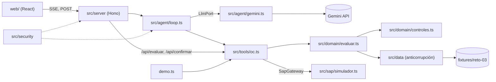

# SOLUCIÓN · Reto 3 · Agente de Órdenes de Compra

Contenido: 1 Arquitectura · 2 Ciclo del agente · 3 Matriz de controles · 4 Seguridad · 5 Adaptador SAP real · 6 Compras retroactivas · 7 Decisiones · 8 Limitaciones

Convención: lo que no pude comprobar en una fuente va marcado «(no verificado)».

## 1. Arquitectura

### Módulos



El servidor sirve también la web compilada, en un solo proceso. `demo.ts` y el chat llaman a la misma función de evaluación.

### Principios (docs/PLAN.md §2)

1. **El código decide; el LLM orquesta y explica.** El dictamen sale de `evaluarSolicitud()`, que es pura.
2. **HITL por código, no por prompt.** `crearOrdenCompra` no se ejecuta sin un token de confirmación humana.
3. **Capa anticorrupción.** `src/data/` valida los fixtures con Zod y los traduce al dominio; si cambia el formato de entrada, cambia solo esa carpeta.
4. **Documentos = datos no confiables** (posible prompt injection).
5. **Mínimo que resuelve del todo.** Cada archivo tiene un solo dueño.

Los tipos compartidos (`Dictamen`, `ToolDef`, `LlmPort`, `SapGateway`, `EventoAgente`) están en `src/domain/contratos.ts`.

## 2. Ciclo del agente

```mermaid
sequenceDiagram
  actor U as Usuario
  participant S as Servidor (Hono)
  participant L as Bucle del agente
  participant G as Gemini
  participant T as Tools (núcleo)
  participant H as Persona (HITL)
  participant P as SAP simulado
  U->>S: POST /api/chat (mensaje)
  S->>L: iniciar turno
  loop hasta 8 iteraciones
    L->>G: historial + definiciones de tools
    G-->>L: texto o tool calls
    L->>T: evaluarSolicitud(id) y otras tools de consulta
    T-->>L: dictamen (datos enmascarados)
    L-->>U: eventos SSE (tool_call, tool_result)
  end
  L-->>U: mensaje con el dictamen
  L-->>U: confirmacion_requerida (token firmado)
  U->>H: revisa el dictamen
  H->>S: POST /api/confirmar (token)
  S->>S: verifica firma, TTL; reevalúa; el hash debe coincidir
  S->>P: crearOrdenCompra(solicitudId, dictamen)
  P-->>S: número de OC (idempotente)
  S-->>U: oc_creada
```

- **Tope de 8 iteraciones:** el bucle LLM ↔ tools se corta a las 8 vueltas para acotar coste y evitar ciclos. Al llegar al tope se responde con error controlado.
- **Por qué el LLM no decide:** un modelo puede equivocarse o ser manipulado por el texto de un documento. El dictamen es una función determinista de los datos; el LLM solo elige qué tool llamar y redacta la explicación. Si el LLM dice otra cosa que el dictamen, manda el dictamen.
- **Pausa HITL:** la tool `crearOrdenCompra` tiene `requiereConfirmacion = true`. El bucle no la ejecuta: emite `confirmacion_requerida` y espera a `/api/confirmar`.
- **Modo «Evaluar sin IA»:** `/api/evaluar` llama directamente a `evaluarSolicitud()` sin pasar por Gemini. Sirve para probar los casos sin clave ni red y para comparar con lo que dice el LLM.

## 3. Matriz de controles

Catálogo **provisional**: los controles y la decisión se cierran con el PRD (docs/PLAN.md §7, B1).

| Control | Qué comprueba | Estado que produce |
|---|---|---|
| `CTRL-PROVEEDOR` | El proveedor existe en el maestro y está activo; el NIT coincide | `BLOQUEO` si no existe o está inactivo |
| `CTRL-CECO-TOPE` | El monto no supera el tope de aprobación del centro de costo | `BLOQUEO` o `ALERTA` según el criterio que fije el PRD |
| `CTRL-IVA` | El indicador de IVA es coherente con el material o servicio y el monto | `ALERTA` si es dudoso, `BLOQUEO` si es inválido |
| `CTRL-COND-PAGO` | La condición de pago corresponde a la del maestro del proveedor | `ALERTA` si difiere |
| `CTRL-RETROACTIVA` | La factura o compra no es anterior a la solicitud o aprobación (ver §6) | `BLOQUEO` |
| `CTRL-COHERENCIA` | Cotización, solicitud y maestros concuerdan (montos, cantidades, moneda, fechas) | `ALERTA` o `BLOQUEO` según la diferencia |

Cada control devuelve `OK`, `ALERTA` o `BLOQUEO` con `detalle` y `evidencia` (contrato `ResultadoControl`).

**Decisión del dictamen:**

- Algún `BLOQUEO` → `RECHAZADA`.
- Si no, alguna `ALERTA` → `REQUIERE_REVISION`.
- Si no → `APROBABLE`.

Los valores de `Decision` también son provisionales (`src/domain/contratos.ts`).

<!-- MATRIZ: se genera con npm run demo -- --md -->

## 4. Seguridad

Resumen de docs/PLAN.md §5. Cada punto indica qué se hace y por qué.

1. **Secretos.** La clave de Gemini solo existe en el servidor. Las variables de entorno se validan con Zod al arrancar (falla rápido si faltan). `redact()` borra claves y tokens de logs y errores. Al cliente solo llega un error genérico con un `correlationId` para buscarlo en logs.
2. **Minimización y enmascarado.** Las tools reciben IDs (`solicitudId`), no documentos completos. Sus salidas pasan por `mask()` (correos, teléfonos, cuentas, documentos de identidad, NIT parcial, nombres → iniciales). La UI pública no tiene login, así que muestra los mismos datos enmascarados que ve el LLM.
3. **Prompt injection.** Los documentos externos se envuelven en `<documento_externo>` con el cierre escapado y el prompt los declara como datos. Además el dictamen no depende del LLM: una instrucción escondida en un documento no cambia el resultado.
4. **XSS.** El texto del LLM se pinta como texto, nunca como HTML. `secureHeaders` de Hono aplica una CSP.
5. **Abuso y coste.** Límite de cuerpo (`bodyLimit`), longitud máxima de mensaje, rate limit por IP, tope de iteraciones y de tokens de salida, y timeout por llamada.
6. **HITL firmado sin estado.** El token es un HMAC-SHA256 (clave `HITL_SECRET`) sobre `{solicitudId, hash, exp}` con TTL de 10 minutos. Al confirmar se reevalúa la solicitud y el hash debe coincidir con el firmado: si los datos cambiaron, el token no vale. Repetir el token no duplica la OC porque el número se deriva de la solicitud (SAP idempotente). No hay almacén de tokens, así que funciona igual con varias instancias.
7. **Cadena de suministro.** Versiones exactas y lockfile (`npm ci`), `npm audit` en CI, y solo se versiona la plantilla de variables, nunca los secretos.
8. **Términos de Gemini.** En el nivel gratuito, Google puede usar entradas y salidas para mejorar sus productos y personas pueden revisarlas; en el de pago, no (fuente: https://aistudio.google.com/docs/terms). Por eso al LLM solo llega información enmascarada, sea cual sea el nivel.

## 5. Adaptador SAP real para producción

### El puerto

El núcleo solo conoce `SapGateway`:

```ts
crearOrdenCompra(solicitudId: string, dictamen: Dictamen): Promise<OrdenCompra>  // idempotente
```

El simulador (`src/sap/simulador.ts`) es una implementación. Para producción se escribe otra que cumpla el mismo contrato; el resto del sistema no cambia. Dos opciones:

| | A. RFC con BAPI | B. OData V4 |
|---|---|---|
| Servicio | `BAPI_PO_CREATE1` + `BAPI_TRANSACTION_COMMIT` | `API_PURCHASEORDER_2` |
| Estado | Vigente como vía de creación de pedidos (fuentes: comunidad SAP y https://userapps.support.sap.com/sap/support/knowledge/en/3689279) | OData V4; sustituye al V2 `API_PURCHASEORDER_PROCESS_SRV`, en desuso desde la release 2308 (https://userapps.support.sap.com/sap/support/knowledge/en/3110493) |
| Encaja con | Sistemas on-premise, red interna | S/4HANA Cloud o ABAP Platform con servicios publicados |

Esos datos de ciclo de vida son de S/4HANA Cloud; en on-premise puede diferir (comprobar con la versión concreta del cliente).

### Conectividad y autenticación (no verificado)

Sin acceso a un SAP real no pude comprobar esto; son criterios de diseño, no hechos del producto:

- **RFC:** requiere llegar al sistema SAP por red interna (VPN o conector en la red del cliente) y un usuario técnico de comunicación con autorización mínima para crear pedidos. Se necesita una biblioteca cliente RFC para Node.js (no verificado cuál).
- **OData:** HTTPS contra el gateway; autenticación según lo que habilite el cliente (OAuth 2.0 o certificado cliente; no verificado cuál es estándar en su sistema). Hay que gestionar el token CSRF en escrituras (no verificado para V4).
- En ambos casos: credenciales en un gestor de secretos, nunca en el repositorio; un usuario técnico por entorno.

### Mapeo de campos

| Dato del dominio | Destino en SAP | Nombre técnico |
|---|---|---|
| Proveedor | Cabecera del pedido | (no verificado) |
| Organización de compras | Cabecera | (no verificado) |
| Grupo de compras | Cabecera | (no verificado) |
| Sociedad | Cabecera | (no verificado) |
| Centro (planta) | Posición | (no verificado) |
| Centro de coste e imputación | Imputación de la posición | (no verificado) |
| Indicador IVA | Posición | (no verificado) |
| Condición de pago | Cabecera | (no verificado) |

Antes de implementar hay que obtener del cliente los códigos reales de cada maestro y confirmar los nombres técnicos en la documentación de su versión.

### Idempotencia

La clave de idempotencia es la solicitud de compra. El adaptador debe:

1. Guardar la solicitud como referencia externa en el pedido (campo concreto: no verificado).
2. Antes de crear, buscar si ya existe un pedido con esa referencia y devolverlo.
3. Ante un timeout, no reintentar a ciegas: consultar primero si el pedido se llegó a crear.

Con RFC hay que tener en cuenta que el pedido no queda guardado hasta ejecutar `BAPI_TRANSACTION_COMMIT`; si falla entre la creación y el commit, no existe pedido (comportamiento transaccional típico de las BAPI; no verificado en detalle).

### Manejo de errores

- **BAPI:** devuelve una tabla de mensajes `BAPIRET2` (nombre del tipo según los datos del encargo; estructura de campos no verificada). Un mensaje de error impide el commit; hay que hacer rollback y traducir los mensajes a errores de dominio.
- **OData:** el cuerpo de error y el código HTTP indican el fallo (formato exacto no verificado).
- Distinguir errores de datos (no se reintentan; vuelven al usuario) de errores de infraestructura (reintentables).

### Reintentos

Solo para errores transitorios (red, timeout, 5xx), con espera exponencial, número máximo de intentos y comprobación de idempotencia antes de cada reintento.

### Observabilidad

- Log estructurado por llamada con `correlationId`, `solicitudId`, duración y resultado; sin datos personales (`redact()`).
- Métricas: tasa de error, latencia, reintentos, OC creadas y rechazadas.
- Alerta ante errores repetidos o latencia anómala.

### Estrategia de pruebas

1. **Contrato:** la misma batería de pruebas se ejecuta contra el simulador y contra el adaptador real (idempotencia, errores).
2. **Integración** contra un sistema de sandbox o de calidad del cliente, con maestros de prueba.
3. **Fallos inyectados:** timeout tras crear, mensaje de error, commit fallido.
4. Piloto con un volumen pequeño y revisión humana de cada OC antes de ampliar.

## 6. Análisis crítico de compras retroactivas

**Qué son.** Compras cuya factura o ejecución es anterior a la solicitud o a su aprobación: se compró primero y se pide el papel después.

**Por qué es un desvío de proceso.** El flujo de compra existe para aprobar antes de comprometer dinero. Una compra retroactiva invierte el orden: la aprobación deja de ser una decisión y pasa a ser un trámite para legalizar algo ya hecho.

**Riesgos.**

- **Control presupuestal:** el gasto ya está comprometido sin saber si había presupuesto.
- **Precio:** sin cotización competitiva previa, no hay forma de comprobar que el precio era razonable.
- **Fraude:** facilita facturas ficticias, proveedores no validados y colusión; el papel se fabrica después.
- **Segregación de funciones:** quien pidió, quien compró y quien aprobó pueden ser la misma persona o actuar en un orden que anula el control cruzado.
- **Fiscal:** un documento fechado antes de la solicitud puede generar problemas con soportes, IVA y retenciones (la normativa concreta debe revisarla un especialista fiscal; no verificado).

**Por qué el agente no debe regularizarlas solo.** Aprobar es una decisión con responsabilidad; el agente no puede asumirla, y el LLM puede ser influido por el texto de los documentos. Crear la OC la convertiría en legalización automática y haría atractivo el atajo. Por eso `CTRL-RETROACTIVA` produce `BLOQUEO` y la solicitud queda en `RECHAZADA`.

**Recomendaciones.**

1. **Bloqueo + flujo de excepción:** la compra retroactiva solo avanza con justificación escrita y aprobación de un nivel superior al habitual, fuera del agente.
2. **KPI:** porcentaje de compras retroactivas por área y por proveedor, con seguimiento mensual.
3. **Causa raíz:** revisar por qué ocurren (urgencias reales, lentitud del proceso, desconocimiento) y atacar esa causa, no solo sancionar.
4. **Conciliación pedido-recepción-factura (3-way match):** comparar la OC, la recepción de mercancía y la factura; las fechas fuera de orden aparecen como excepción.

<!-- DATOS REALES B3 -->

## 7. Decisiones

### ADR-1: Núcleo determinista + LLM orquestador

- **Contexto:** el dictamen de una compra debe ser repetible y auditable; un LLM no garantiza eso y puede ser manipulado por documentos.
- **Decisión:** `evaluarSolicitud()` es una función pura sobre los datos; el LLM solo llama tools y redacta la explicación.
- **Consecuencias:** mismo dictamen y hash para el mismo expediente; se puede probar sin red (`demo.ts`, «Evaluar sin IA»). Coste: las reglas nuevas hay que codificarlas, no pedirlas en el prompt.

### ADR-2: HITL por código con token HMAC sin estado

- **Contexto:** «pedir confirmación» en el prompt no es una garantía; el modelo puede saltárselo.
- **Decisión:** el servidor no ejecuta `crearOrdenCompra` sin un token HMAC-SHA256 sobre `{solicitudId, hash, exp}`, TTL de 10 min, y reevalúa al confirmar.
- **Consecuencias:** no hay almacén de tokens y escala sin estado compartido. Un token no se puede revocar antes del TTL; el daño lo limita la idempotencia (repetir no duplica).

### ADR-3: Bucle propio en vez de framework de agentes

- **Contexto:** el flujo es corto: llamar al modelo, ejecutar tools, parar o pedir confirmación.
- **Decisión:** bucle propio en `src/agent/loop.ts` sobre un puerto `LlmPort`; el SDK de Gemini queda detrás de un adaptador.
- **Consecuencias:** menos dependencias, control exacto de la pausa HITL y del tope de iteraciones; cambiar de proveedor es escribir otro adaptador. Se asume el mantenimiento del bucle.

### ADR-4: Hono + Vite en un solo proceso, en Railway

- **Contexto:** hace falta una URL pública con servidor (secretos, SSE) y web.
- **Decisión:** un proceso Hono sirve la API y la web compilada. Railway construye con Railpack y respeta `engines.node`; el trial es de 30 días con 5 USD (https://docs.railway.com/pricing/free-trial).
- **Consecuencias:** un solo servicio que desplegar y sin problemas de CORS. La escala se limita a lo que aguante un proceso; con el token sin estado se puede replicar.

### ADR-5: Gemini con minimización de datos

- **Contexto:** en el nivel gratuito Google puede usar entradas y salidas y personas pueden revisarlas (https://aistudio.google.com/docs/terms).
- **Decisión:** al LLM solo llegan IDs y salidas pasadas por `mask()`. Modelo por defecto `gemini-3.6-flash`, configurable con `GEMINI_MODEL`.
- **Consecuencias:** el modelo ve menos datos y la explicación puede ser menos específica. Con datos reales conviene el nivel de pago o un acuerdo con el proveedor.

### ADR-6: Capa anticorrupción para los fixtures

- **Contexto:** los datos de entrada pueden cambiar de formato (los reales llegan después de escribir el código).
- **Decisión:** `src/data/` valida con Zod y traduce al dominio; controles y agente no conocen el formato crudo.
- **Consecuencias:** adaptarse a otro formato toca solo `src/data/`. Hay una traducción extra que mantener.

## 8. Limitaciones y siguientes pasos

- Los controles y los valores de `decision` son provisionales hasta cerrar la matriz con el PRD.
- El SAP es simulado; el adaptador real (§5) no está implementado ni probado. Nombres técnicos, autenticación y conectividad quedan por verificar contra el sistema del cliente.
- Sin login: la URL pública no distingue usuarios; el rate limit por IP es una defensa básica.
- El número de OC se deriva de la solicitud y no es un número SAP real.
- Las cifras de compras retroactivas (§6) dependen de los casos reales.
- Siguientes pasos: cerrar la matriz y los casos esperados con el PRD; implementar el adaptador SAP contra un entorno de pruebas; añadir evaluaciones del agente (casos reales, pasa/no pasa) para cambios de prompt o modelo; autenticación de usuarios.
